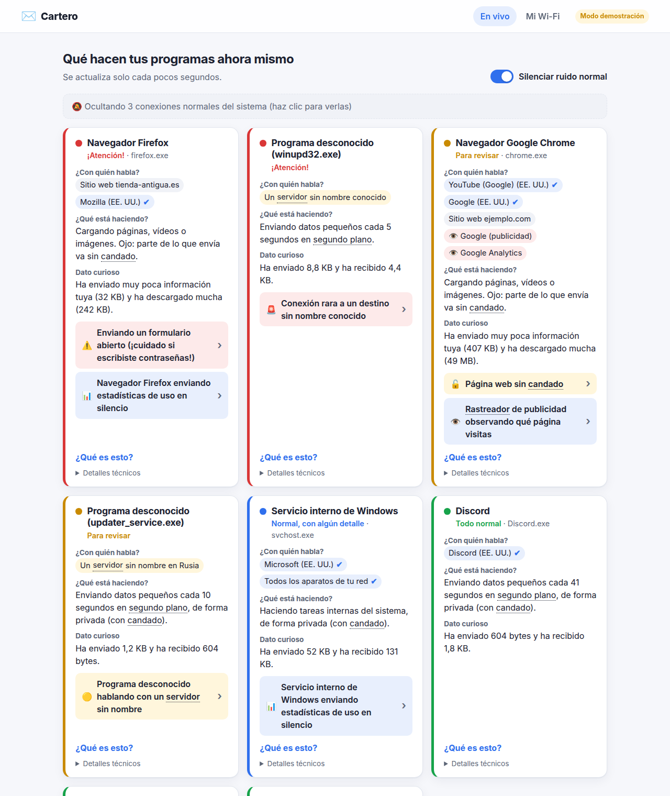
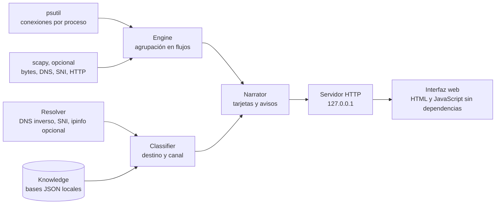

# Cartero

Mira qué cartas envía tu ordenador por Internet.

Monitor de red para usuarios sin conocimientos técnicos. Muestra qué programas de tu ordenador se comunican por Internet, con quién lo hacen y si hay motivos para preocuparse, explicado en lenguaje cotidiano.

[](https://github.com/pablomtz-ti/cartero/actions/workflows/ci.yml)




## Motivación

Herramientas como Wireshark son muy potentes, pero presuponen que el usuario entiende conceptos como TCP, DNS o TLS. Cartero parte del problema contrario: una persona sin formación técnica quiere saber si su ordenador está haciendo algo raro. En lugar de listar paquetes, la aplicación agrupa la actividad por programa y responde a tres preguntas: con quién habla, qué está haciendo y si debería preocuparse.

## Modelo conceptual

La interfaz utiliza la metáfora del envío postal. Cada conexión se presenta como una carta que sale de tu casa hacia un destinatario.

| Concepto de red | Representación en Cartero |
|---|---|
| Proceso local | Remitente ("Navegador Google Chrome") |
| Dirección IP de destino | Destinatario identificado ("Google, EE. UU.") |
| Tráfico cifrado (HTTPS, QUIC, SSH) | Sobre cerrado: nadie en el camino puede leer el contenido |
| Tráfico en claro (HTTP, DNS) | Postal abierta: cualquiera en la misma red podría leerla |

Ningún término técnico aparece en el texto principal. Los datos de bajo nivel (IP, puerto, protocolo, dominio) quedan disponibles en una sección plegable de detalles técnicos.

| Evento técnico | Descripción que muestra Cartero |
|---|---|
| `POST /login.php (x-www-form-urlencoded)` sobre HTTP | Enviando un formulario abierto (cuidado si escribiste contraseñas) |
| `TCP 443 -> v10.events.data.microsoft.com` | Servicio interno de Windows enviando estadísticas de uso en silencio |
| Petición a `doubleclick.net` | Rastreador de publicidad observando qué página visitas |
| `UDP 8801 <-> zoom.us`, 1,2 MB/s | Llamada de voz o vídeo, o transmisión en directo |
| `TCP 4444 ->` IP sin nombre | Conexión rara a un destino sin nombre conocido |
| Paquetes de 60 bytes cada 10 s | Enviando datos pequeños cada 10 segundos en segundo plano |

## Funcionalidades

| Inicio | Resultado del escaneo |
|---|---|
|  |  |

- Escaneo rápido: observa la actividad durante 30 segundos y emite un veredicto en tres niveles (sin incidencias, para revisar, atención).
- Vista en vivo: una tarjeta por programa que se actualiza automáticamente.
- Dispositivos de la red local: identifica el router, el propio equipo y el resto de aparatos con nombres comprensibles ("iPhone de Juan", "Samsung TV", "Aparato inteligente"), detecta móviles que usan direcciones MAC privadas y señala los dispositivos desconocidos.
- Explicación de avisos: cada alerta responde a qué está pasando, por qué importa y qué debe hacer el usuario.
- Consulta "¿Qué es esto?": explicación breve del programa y del destino, con enlaces a una búsqueda web y a VirusTotal que solo se abren a petición del usuario.
- Reducción de falsas alarmas:
  - El filtro de ruido normal, activo por defecto, oculta actualizaciones del sistema, antivirus y sincronización en la nube, e indica cuántas conexiones se han ocultado.
  - Las empresas conocidas (Microsoft, Apple, Google, Amazon, Cloudflare, entre otras) se marcan como verificadas.
  - Un glosario contextual muestra una definición breve al pasar el ratón sobre términos como servidor, candado o rastreador.


## Instalación

Requiere Python 3.10 o superior.

```bash
git clone https://github.com/pablomtz-ti/cartero.git
cd cartero
python -m venv .venv
source .venv/bin/activate        # En Windows: .venv\Scripts\activate
pip install -e .
```

## Uso

```bash
cartero --demo            # escenario ficticio, no requiere permisos
cartero                   # tráfico real en modo básico
sudo cartero --captura    # análisis completo con captura de paquetes
cartero update-data       # descarga listas ampliadas de rastreadores y fabricantes
```

La interfaz se abre en el navegador en `http://127.0.0.1:8765`.

| Modo | Requisitos | Información disponible |
|---|---|---|
| `--demo` | Ninguno | Escenario simulado que cubre todas las reglas de detección |
| Básico | Usuario sin privilegios (1) | Programa, destino, cifrado y comunicaciones periódicas detectadas por reconexión |
| `--captura` | Administrador y `pip install -e ".[captura]"` | Además: volumen de datos por programa, nombres obtenidos de DNS y SNI, formularios HTTP en claro e intervalos exactos |
| `--online` | Conexión a Internet | Además: país y organización de destinos sin nombre mediante ipinfo.io. Es opcional y envía esas direcciones a un tercero |

(1) Sin privilegios, Linux y Windows no exponen los procesos de otros usuarios; Cartero los agrupa como "Programas protegidos del sistema" e informa de ello. En macOS se necesita `sudo` para ver la mayoría de procesos.

## Arquitectura



El análisis combina cuatro fuentes de información antes de generar cada tarjeta:

1. Infraestructura conocida ([`known_domains.json`](src/cartero/data/known_domains.json), [`ip_ranges.json`](src/cartero/data/ip_ranges.json)): más de 170 dominios y rangos de CDN, telemetría y servicios del sistema. La búsqueda se hace por el sufijo de dominio más largo respetando los límites de etiqueta, de modo que `notgoogle.com` no coincide con `google.com`.
2. Rastreadores ([`trackers.json`](src/cartero/data/trackers.json)), ampliable con la lista de Disconnect.me mediante `cartero update-data`.
3. Patrones de comportamiento ([`behavior.py`](src/cartero/behavior.py)):
   - Mucho tráfico de bajada y poco de subida: consumo de contenido.
   - Mucho tráfico de subida: subida de archivos, copia de seguridad o videollamada.
   - Envíos pequeños a intervalos regulares (coeficiente de variación inferior a 0,25): comunicación periódica o heartbeat.

   Sin captura de paquetes, la periodicidad se estima a partir de las reconexiones.
4. Identificación de procesos ([`processes.json`](src/cartero/data/processes.json)): traduce nombres como `svchost.exe` o `mDNSResponder` a descripciones comprensibles.

Para nombrar cada destino se consultan, por orden de fiabilidad, estas fuentes:

- Las respuestas DNS y el campo SNI observados durante la captura. El ClientHello de TLS se analiza con un parser propio, en [`capture.py`](src/cartero/capture.py).
- La resolución inversa de DNS, que se hace en segundo plano.
- ipinfo.io, solo si el usuario lo activa expresamente.

## Privacidad y seguridad

- Ningún dato sale del equipo salvo que se utilicen `--online` o `update-data` de forma explícita.
- No se almacena el contenido de los paquetes. Solo se contabilizan bytes y se leen nombres de dominio. De un formulario enviado en claro se registra únicamente que existió, no su contenido.
- El servidor escucha exclusivamente en `127.0.0.1`. Además:
  - valida la cabecera `Host` como protección frente a DNS rebinding;
  - aplica una Content-Security-Policy restrictiva;
  - impide el acceso a rutas fuera del directorio de la interfaz.
- La interfaz inserta todo el contenido procedente de la red mediante `textContent` y nunca mediante `innerHTML`, lo que evita la inyección de HTML a través de nombres de dominio manipulados.

## Desarrollo

```bash
pip install -e ".[dev]"
pytest
ruff check .
```

La batería de pruebas cubre el clasificador, el generador de textos, el parser de TLS y HTTP, la lectura de la tabla ARP en los tres sistemas operativos y el servidor. La integración continua ejecuta lint y pruebas en Linux, macOS y Windows con Python 3.10 y 3.13.

```
src/cartero/
├── cli.py          punto de entrada y opciones de línea de comandos
├── engine.py       agrupación de conexiones en flujos y escaneo
├── collector.py    lectura de conexiones del sistema (psutil)
├── capture.py      captura opcional: bytes, DNS, SNI y formularios HTTP
├── resolver.py     resolución de nombres no bloqueante
├── classifier.py   clasificación de destinos y canales
├── behavior.py     detección de periodicidad y asimetría
├── narrator.py     generación de tarjetas, avisos y veredicto
├── wifi.py         descubrimiento de dispositivos en la red local
├── demo.py         escenario simulado
├── server.py       API y ficheros estáticos
├── data/           bases de conocimiento en JSON
└── web/            interfaz (HTML, CSS y JavaScript)
```

## Trabajo futuro

- Distribución como ejecutable único para Windows y macOS.
- Historial de actividad por programa.
- Detección de DNS sobre HTTPS y de VPN activas.
- Interfaz en inglés.

## Licencia

Distribuido bajo licencia [MIT](LICENSE).
