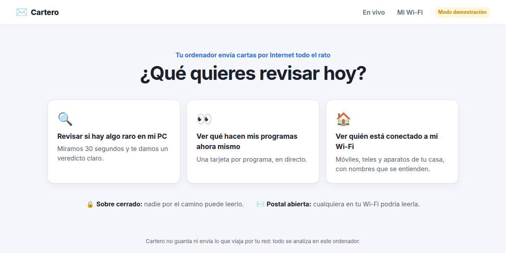
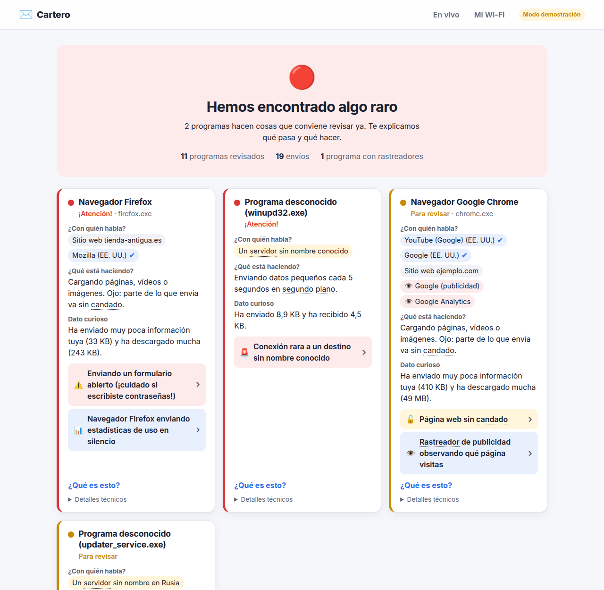
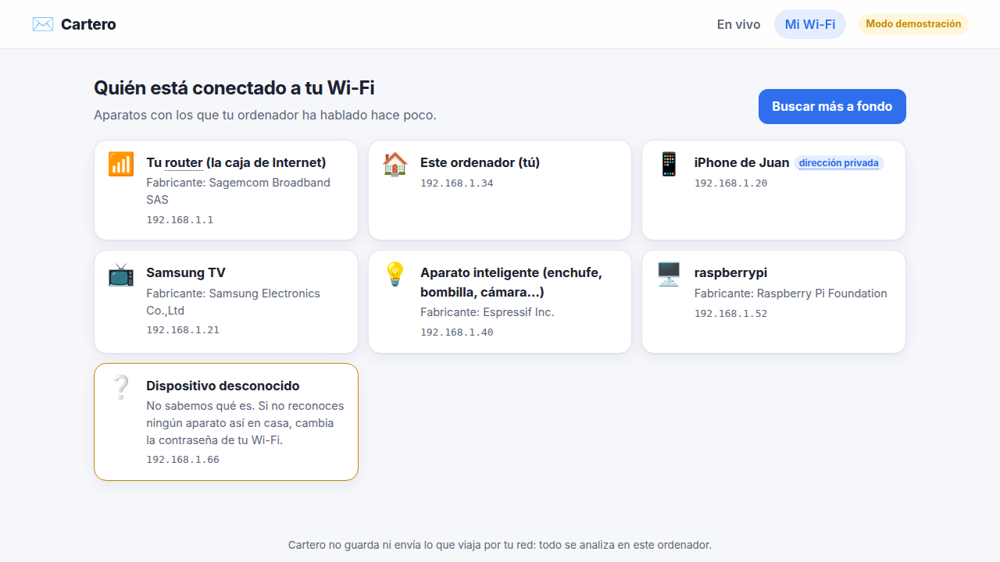
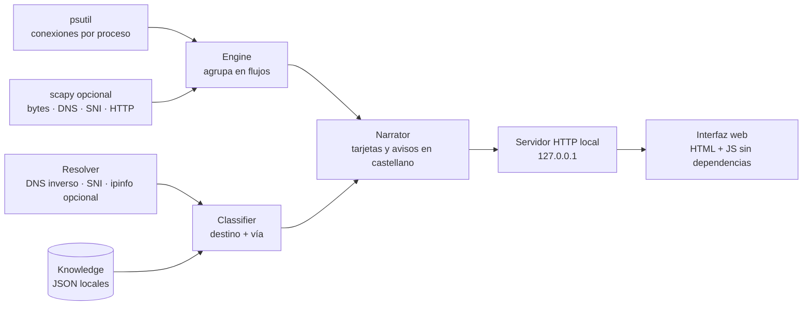

<div align="center">

# ✉️ Cartero

**Mira qué cartas envía tu ordenador por Internet, explicado para humanos.**

[](https://github.com/pablomtz-ti/cartero/actions/workflows/ci.yml)


</div>

Wireshark es fantástico… si sabes qué es un *TLS Client Hello*. **Cartero** es un monitor de red
para el resto del mundo: en lugar de tablas de paquetes, enseña **una tarjeta por programa** que
responde en castellano llano a tres preguntas: *¿con quién habla?*, *¿qué está haciendo?* y
*¿debería preocuparme?*

## La metáfora: el rastreador de cartas

| Red | Cartero |
|---|---|
| Tu PC / un proceso | **Tu casa** (o "tu navegador Chrome") |
| IP de destino `142.250.184.14` | **"Servidores de Google (EE. UU.)"** |
| Tráfico cifrado (HTTPS, QUIC, SSH…) | 🔒 **Sobre cerrado y lacrado**: nadie en el camino puede leerlo |
| Tráfico en claro (HTTP, DNS…) | ✉️ **Postal abierta**: cualquiera en tu Wi-Fi podría leerla |

### Traducción total de conceptos técnicos

| Lo que dice Wireshark | Lo que dice Cartero |
|---|---|
| `POST /login.php (x-www-form-urlencoded)` | ⚠️ Enviando un formulario abierto (¡cuidado si escribiste contraseñas!) |
| `TCP 443 → v10.events.data.microsoft.com` | 📊 Servicio interno de Windows enviando estadísticas de uso en silencio |
| `GET /pixel?id=9928 → doubleclick.net` | 👁️ Rastreador de publicidad observando qué página visitas |
| `UDP 8801 ↔ zoom.us, 1,2 MB/s` | Llamada de voz o vídeo, o transmisión en directo |
| `TCP 4444 → IP sin nombre` | 🚨 Conexión rara a un destino sin nombre conocido |
| Paquetes de 60 B cada 10,0 s | Enviando datos pequeños cada 10 segundos en segundo plano |

## Qué hace

<table>
<tr>
<td width="50%"></td>
<td width="50%"></td>
</tr>
<tr>
<td><b>Un botón, una pregunta.</b> Sin menús ni configuración: «¿Qué quieres revisar hoy?»</td>
<td><b>Modo detective.</b> Escanea 30 segundos y da un veredicto claro con semáforo.</td>
</tr>
</table>

- **🔍 Revisar si hay algo raro**: 30 segundos de observación → veredicto 🟢 / 🟡 / 🔴.
- **👀 Feed en vivo**: tarjetas agrupadas por programa, actualizadas solas.
- **🏠 ¿Quién está en mi Wi-Fi?**: "Tu router", "iPhone de Juan", "Samsung TV", "Aparato inteligente
  (enchufe, bombilla…)", detección de móviles con **dirección privada** y aviso de dispositivos desconocidos.
- **🚦 Semáforo de riesgo**: cada aviso responde *¿Qué está pasando? · ¿Por qué importa? · ¿Qué debo hacer?*
- **🔎 «¿Qué es esto?»**: explicación de dos líneas + enlaces a Google y VirusTotal (nunca se consultan solos).
- **Funciones anti-pánico**:
  - *Silenciar ruido normal* (activado por defecto): oculta actualizaciones, antivirus y sincronización
    en la nube: «Ocultando 42 conexiones normales del sistema (haz clic para verlas)».
  - *Sello azul ✔* para empresas conocidas y verificadas (Microsoft, Apple, Google, Amazon, Cloudflare…).
  - *Glosario contextual*: pasa el ratón por *servidor*, *candado*, *rastreador*, *segundo plano*… y aparece
    un bocadillo con un ejemplo cotidiano.



## Instalación

```bash
git clone https://github.com/pablomtz-ti/cartero.git
cd cartero
python -m venv .venv && source .venv/bin/activate   # Windows: .venv\Scripts\activate
pip install -e .
```

## Uso

```bash
cartero --demo            # ordenador ficticio con casos típicos: ideal para probarlo
cartero                   # tu tráfico real (modo básico, sin permisos especiales)
sudo cartero --captura    # análisis completo: datos subidos/bajados, nombres reales, formularios en claro
cartero update-data       # descarga listas completas de rastreadores (Disconnect.me) y fabricantes (IEEE)
```

Se abre solo en el navegador en `http://127.0.0.1:8765`.

| Modo | Permisos | Qué ve |
|---|---|---|
| `--demo` | ninguno | Un escenario inventado que recorre todas las reglas |
| básico | usuario normal¹ | Qué programa habla con quién, cifrado sí/no, latidos por reconexión |
| `--captura` | administrador + `pip install -e ".[captura]"` | + bytes por programa (asimetría), DNS y SNI, formularios HTTP, ritmo exacto de latidos |
| `--online` | — | + país y empresa de destinos sin nombre vía ipinfo.io (**opcional**, envía esas IP a un tercero) |

¹ En Linux y Windows sin privilegios no se ven los procesos de otros usuarios; Cartero lo indica y los agrupa
como «Programas protegidos del sistema». En macOS hace falta `sudo` para ver la mayoría.

## Cómo funciona



Antes de pintar nada, el motor hace **cuatro cruces automáticos**:

1. **Ruido conocido** ([`known_domains.json`](src/cartero/data/known_domains.json), [`ip_ranges.json`](src/cartero/data/ip_ranges.json)):
   más de 170 dominios y rangos de CDN, telemetría y servicios del sistema, buscados por sufijo de dominio más largo
   (`notgoogle.com` nunca coincide con `google.com`).
2. **Rastreadores** ([`trackers.json`](src/cartero/data/trackers.json) + lista de Disconnect.me con `update-data`).
3. **Asimetría y ritmo** ([`behavior.py`](src/cartero/behavior.py)):
   *mucho baja, poco sube* → consumiendo contenido; *mucho sube* → subiendo archivos o videollamada;
   *paquetes diminutos a intervalos regulares* (coeficiente de variación < 0,25) → latido / esperando órdenes.
   Sin captura, los latidos se detectan por las reconexiones periódicas.
4. **Explicador de procesos** ([`processes.json`](src/cartero/data/processes.json)): `svchost.exe` →
   «Servicio interno de Windows», `mDNSResponder` → «Buscador de dispositivos en tu Wi-Fi».

El nombre del destino se obtiene, por orden de fiabilidad, de: respuestas DNS y SNI vistas en la captura
(con un parser propio de TLS ClientHello, [`capture.py`](src/cartero/capture.py)), DNS inverso en segundo plano y,
solo si se pide, ipinfo.io.

## Privacidad y seguridad

- **Nada sale de tu ordenador** salvo que actives `--online` o `update-data`, y los enlaces de «¿Qué es esto?»
  solo se abren si haces clic.
- **No se guarda el contenido de los paquetes**: solo se cuentan bytes y se leen nombres de dominio.
  De un formulario en claro solo se anota *que existió*, nunca lo que contenía.
- El servidor escucha **solo en `127.0.0.1`**, valida la cabecera `Host` (protección contra *DNS rebinding*),
  envía una *Content-Security-Policy* estricta y bloquea el *path traversal*.
- La interfaz pinta todo lo que llega de la red con `textContent` (nunca `innerHTML`), así que un dominio
  malicioso no puede inyectar HTML.

## Desarrollo

```bash
pip install -e ".[dev]"
pytest          # 36 tests: clasificador, narrador, parser TLS/HTTP, ARP multiplataforma, servidor…
ruff check .
```

La integración continua ejecuta lint y tests en Linux, macOS y Windows con Python 3.10 y 3.13.

```
src/cartero/
├── cli.py          # punto de entrada y opciones
├── engine.py       # agrupa conexiones en flujos, escaneo de 30 s
├── collector.py    # conexiones del sistema (psutil)
├── capture.py      # captura opcional: bytes, DNS, SNI, formularios HTTP
├── resolver.py     # nombres de destino sin bloquear
├── classifier.py   # destino (empresa, país, rastreador…) y vía (sobre cerrado / postal)
├── behavior.py     # latidos, asimetría, formateo en castellano
├── narrator.py     # tarjetas, avisos con 3 preguntas, veredicto
├── wifi.py         # dispositivos de la red (ARP/NDP en Linux, macOS y Windows)
├── demo.py         # ordenador ficticio
├── server.py       # API + estáticos en 127.0.0.1
├── data/           # bases de conocimiento en JSON
└── web/            # interfaz (HTML, CSS y JS sin dependencias)
```

## Hoja de ruta

- [ ] Empaquetado como ejecutable único para Windows y macOS (PyInstaller).
- [ ] Historial: «¿qué hizo este programa ayer?».
- [ ] Detección de DNS sobre HTTPS y VPNs activas.
- [ ] Traducción de la interfaz al inglés.

## Licencia

[MIT](LICENSE) © Pablo Martínez
